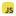
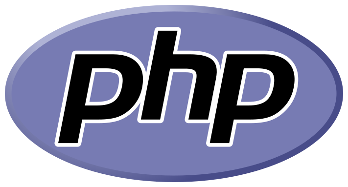
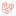
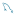

Hi 👋, I'm Abdul Rasyid. I focus on web development and have worked on several PHP-based projects using the Laravel framework. I'm currently expanding my skills by learning new technologies such as Vue.js, Next.js, and Express.js.

Have a question or want to talk about web development? You can reach me through:

- 📩Email: abdulrazid608@gmail.com
- 📌Linkedin: https://www.linkedin.com/in/abdulrasyid7

Language and tools

    
    
    
    
    
    
    
    

